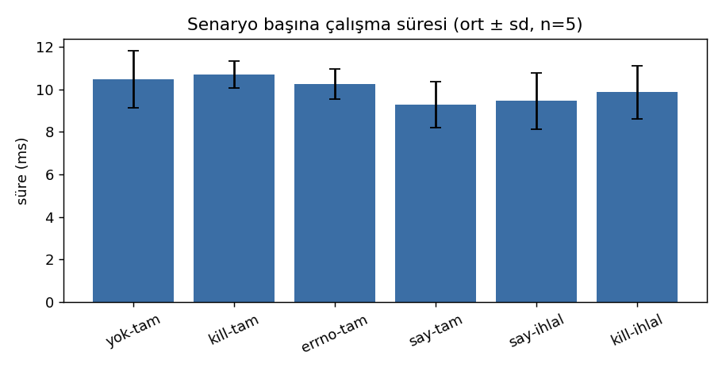

# K2 — Ortam ve İlk Ölçüm

> **Durum: ön ölçüm (01.11.2026, v0.2 kodu ile yeniden alındı).** K2 teslim tarihi 26.11.2026'dır; aşağıdaki ölçümler bu
> makinede alındı ve K2 öncesinde temiz Ubuntu 24.04 ortamında (Docker/VM) **tekrarlanıp bu rapor
> güncellenecek.** Her sayı `olcum/2026-11-01-olcum.csv` dosyasındaki ham verinin özetidir.

## 1. Ortam
`make surum` ve `olcum/2026-11-01-ozet.md` çıktısı:
```
Linux 7.0.0-42-generic #42~24.04.1-Ubuntu SMP PREEMPT_DYNAMIC x86_64
gcc (Ubuntu 13.3.0-6ubuntu2~24.04.1) 13.3.0 ; glibc 2.39
libseccomp 2.5.5-1ubuntu3.1 (statik, .deps; sudo yokluğu nedeniyle)
strace 6.8 ; CPU: 13th Gen Intel(R) Core(TM) i5-13500H, nproc 16
kernel.dmesg_restrict=1, kernel.yama.ptrace_scope=1   (OS/glibc/ptrace_scope satırları: olcum/2026-11-01-ozet.md)
```
Geliştirme makinesi Zorin OS 18 (Ubuntu 24.04 tabanlı). Sudo parola istediği için
`libseccomp-dev` sistem paketi yerine `scripts/kur-rootsuz.sh` ile kuruldu (statik bağlama).

## 2. Yöntem
`docs/05-olcum-yontemi.md`: 6 senaryo, her birinde 1 ısınma + 5 ölçülen tekrar, ortalama ± örnek
standart sapma. Komut: `bash scripts/calistir.sh && TARIH=2026-11-01 bash tools/olcum.sh`.

## 3. Profil
3 senaryo (normal/hata/socket) × 3 koşu `strace -f` ile izlenip birleştirildi:
**45 izinli, 323 kapalı, toplam 368 (%87,8 daralma)** (`profil_uret --ozet`).
Determinizm: iki ayrı üretimde `sha256sum`:
```
6ac7efd2c8462c38a5a43143068be7cb051a2fbace9164bdf615d0528e21eab1  hedef.seccomp (her ikisi)
8de743bff8b0a270d86871e033d6b3306bcff172668bee65f3b7d77d545bbcd0  hedef.bpf (her ikisi; 52 talimat)
```

## 4. Sonuçlar (ortalama ± standart sapma, n=5)

| Senaryo | syscall sayisi (ort) | engellenen (ort) | sure_ms | min–max ms | rss_kb | exit |
|---|---|---|---|---|---|---|
| yok-tam | 119.8 | 0.0 | 10.46 ± 1.34 | 8.89–12.05 | 10684 ± 69 | 0 |
| kill-tam | 119.8 | 0.0 | 10.70 ± 0.62 | 9.79–11.49 | 10634 ± 57 | 0 |
| errno-tam | 120.2 | 0.0 | 10.27 ± 0.71 | 9.33–11.08 | 10606 ± 5 | 0 |
| say-tam | 120.0 | 0.0 | 9.27 ± 1.08 | 7.90–10.19 | 10607 ± 91 | 0 |
| say-ihlal | 97.2 | 1.0 | 9.45 ± 1.32 | 7.66–10.76 | 10607 ± 91 | 0 |
| kill-ihlal | 95.0 | 1.0 | 9.86 ± 1.26 | 7.97–11.44 | 10659 ± 114 | 159 |

syscall sayisi ve engellenen: tekrarlarin ortalamasi; exit: tum tekrarlarda ayni deger. Standart sapma: ornek sapmasi (n-1). Ham veri: `olcum/2026-11-01-olcum.csv`.



## 5. Yorum
- **Filtre, programın yaptığı çağrıların sayısını değiştirmiyor; kümeyi daraltıyor.** (`syscall_sayisi`
  sütunu her tekrarda *filtresiz* ayrı bir `strace` koşusundan geldiği için bu cümleyi tek başına kanıtlamaz;
  kanıt T10'dur: profilli ve profilsiz stdout aynı.) Tekrarlar arası oynama gerçektir ve küçüktür
  (örn. kill-tam 119–120, say-tam 119–121; say-ihlal 95–106: thread zamanlaması).
- **Filtre ek yükü bu ölçekte gürültüden ayırt edilemiyor:** 10,46 ± 1,34 ms (filtresiz) ve
  10,70 ± 0,62 ms (KILL); fark (0,24 ms) standart sapmadan küçük. SAY modu (ptrace) filtresizden *hızlı*
  görünüyor (9,27 ± 1,08): bu da ölçüm gürültüsünün kanıtıdır, bir hız kazancı iddiası değildir.
  "Ek yük yok" demiyoruz; çözünürlük yetmiyor (n=5, ~10 ms, fork+exec baskın).
- RSS sütunu bağımsız yöntemlerle doğrulandı (`olcum/2026-11-01-rss.txt`): hedef tek başına
  `time -v` 10608–10736 KB, sandbox'ın kendi ayak izi 1256 KB.
- İhlal senaryolarında `kill-ihlal` exit 159 (=128+SIGSYS), `say-ihlal` 1 engellenen çağrı
  (`unshare`) sayıyor.

## 6. Bilinen eksikler (K2'ye kalan gerçek iş)
1. Temiz Ubuntu 24.04 ortamında tekrar ve rapor güncellemesi.
2. Daha uzun koşan, syscall-yoğun bir yükle filtre ek yükünü ölçülebilir kılmak (CPU-bağımlı `hesap` senaryosu syscall yapmadığı için ek yükü göstermez).
3. `yok-tam` ve `kill-tam` farkı için eşleştirilmiş (paired) karşılaştırma.
